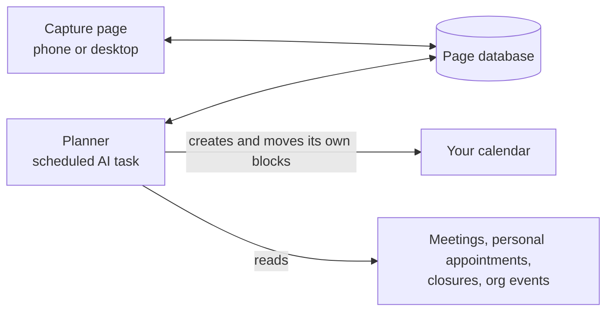

# AI Task Planner

A personal planning assistant built from three small pieces: a capture page, a scheduled AI planner, and your Google Calendar. You jot down an idea from your phone or computer, and every morning the planner breaks it into tasks, estimates how long each takes, and puts time blocks on your calendar around your meetings. You approve the plan just by leaving the blocks where they are.

It was built for one busy higher-education manager who gets pulled in many directions and loses track of where he left off. The design docs explain each choice, so you can keep what fits and change what doesn't.

> **Status:** working prototype, in daily use since October 2026. Expect rough edges. Feedback and forks are welcome.

## How it works



1. **Capture.** Type an idea, pick an area and how urgent it is, and save. That's it.
2. **Plan.** Early every workday the planner reads new ideas, breaks them into ordered tasks, pads the estimates, and schedules them into your work hours. It avoids meetings, keeps a lunch gap, adds breaks, and protects time for personal appointments.
3. **Approve on the calendar.** A block you leave is approved. Drag it and it stays where you put it. Delete it and the task is dropped. The planner never deletes events.
4. **Look ahead.** Only the next two weeks go on the calendar. Longer projects get a forecast finish date on the page.

There's no server and no code to deploy. The planner is a set of instructions run on a schedule. The page is a single HTML file with a small database.

## What you need

- A **Claude** plan with scheduled tasks and published pages (artifacts) with a database
- **Google Calendar** connected to Claude (Gmail too, if you want ideas forwarded by email)
- Optional: a **Google Apps Script** to color calendar blocks by area (the calendar connection can't set colors)

## Start here

| If you want to… | Read |
|---|---|
| Understand the design | [`docs/design/architecture.md`](docs/design/architecture.md), then [`docs/design/decisions.md`](docs/design/decisions.md) |
| Build your own | [`docs/guides/setup.md`](docs/guides/setup.md) |
| Work out your own rules (hours, caps, areas) | [`prompts/setup-interview.md`](prompts/setup-interview.md): paste it into Claude and answer its questions |
| Use it day to day | [`docs/guides/using-it.md`](docs/guides/using-it.md) |
| Avoid problems we already hit | [`docs/guides/lessons-learned.md`](docs/guides/lessons-learned.md) |
| Adapt it for home instead of work | [`examples/personal-adaptation.md`](examples/personal-adaptation.md) |
| See rules for one specific employer | [`examples/maricopa-rules.md`](examples/maricopa-rules.md) |

## Repository layout

```
docs/design/     architecture and decision records (the "why")
docs/guides/     setup, daily use, lessons learned (the "how")
prompts/         the planner prompts and the setup interview
app/             the capture page (one HTML file)
scripts/         Apps Script that colors calendar blocks
config/          every value you need to fill in, in one place
examples/        sample rule sets and adaptations
```

Anything in `{{DOUBLE_BRACES}}` is a placeholder. [`config/example-config.md`](config/example-config.md) lists them all.

## A note on data

The planner reads your calendars and writes task blocks to one of them. Before using it at work, check your organization's AI and data policies. Keep protected records, such as student or employee data, out of what you capture.

## License

- Code, prompts, and the capture page: [MIT](LICENSE)
- Documentation (everything in `docs/` and `examples/`): [CC BY 4.0](LICENSE-DOCS.md)

© 2026 Gordon Inman (ExploreLearnMake). You can reuse and adapt both. Please give credit.
