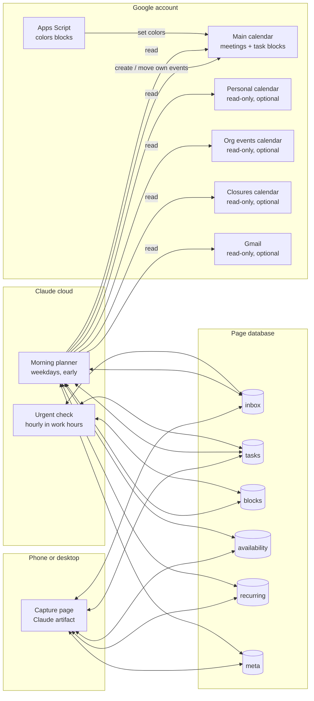
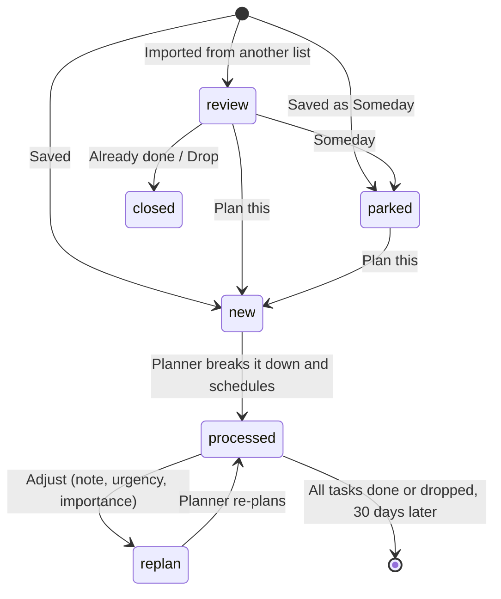
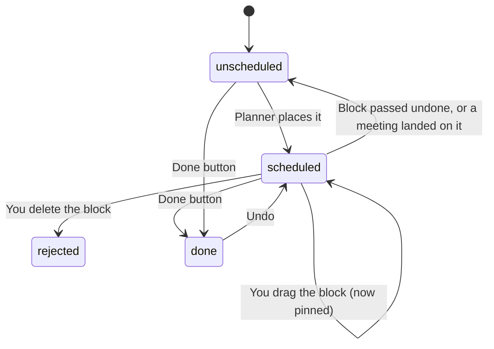

# Architecture

How the AI Task Planner is put together. The reasons behind each choice are in [`decisions.md`](decisions.md).

## The pieces



There are only two moving parts that think. The **capture page** is a static HTML page with a small database. The **planner** is a prompt run on a schedule with access to your calendar. There's no server, no code to deploy, and no API keys.

| Component | Built with | Job |
|---|---|---|
| Capture page | Claude artifact (one HTML file) with a database, readable and writable only by you | Capture ideas; show the queue, calendar blocks, projects, and completed work; Done/Undo; Adjust; settings |
| Database | The artifact's built-in document store | Shared state between the page and the planner |
| Morning planner | Claude scheduled task (cloud), weekdays before work | Everything that thinks: breakdown, estimates, scheduling, syncing with the calendar, forecasting |
| Urgent check | Claude scheduled task, hourly during work hours | Places "Urgent: today" items the same day; otherwise stops immediately |
| Calendar | Google Calendar connection | Source of busy time and destination for task blocks |
| Color script | Google Apps Script in your account | Colors blocks by area, since the calendar connection can't set colors |
| Email (optional) | Gmail connection, read-only | Picks up ideas forwarded from another system |

## Data model

```
inbox/{ideaId}
  text, details, area, urgency (someday|normal|soon|tomorrow|today)
  importance (high|medium|low), dueBy, notBefore
  source (page|email|import), status (review|parked|new|replan|processed|closed)
  notes[{text, at}]                    appended by Adjust, never edited
  flags[{type, text, at, dismissed, key}]
  forecastEnd, createdAt

tasks/{taskId}
  title, project, ideaId (null for recurring), area, order
  kind (deep|admin|prep|followup|learn)
  estimateMin (padded), waitMin (minimum wait before the next step)
  why, suggested, inputs[], people[], links[{title,url}], checklist[]
  urgency, importance, dueBy, notBefore, busy, pinned
  status (scheduled|unscheduled|done|rejected)
  start, end, plannedDate, eventId, carriedOver, recurringId, doneAt

blocks/{id}          planner-made events that aren't tasks:
  type (ooo|travel|break|orgEvent), start, end, eventId, sourceKey, status

availability/{id}    from, to, kind (out|light), note
recurring/{id}       title, area, cadence, day, minutes
meta/config          orgEventKeywords[], altSchedule {start, end}
meta/ingested        messageIds[], itemKeys[]   (email de-duplication)
meta/status          lastRun, lastUrgentRun, summary, problems[]
```

## Idea lifecycle



## Task lifecycle



## The morning run

Order matters. Each step depends on the ones before it.

| Step | What happens |
|---|---|
| 0 | Read the database and calendars (meetings, personal calendar, org events, closures) |
| 1 | Pick up ideas forwarded by email (optional) |
| 2 | Protect time: out-of-office blocks for personal appointments, travel time for off-site meetings, copies of must-attend org events, break + email blocks |
| 3 | Sync with the calendar: deleted blocks → dropped, moved blocks → pinned, missed blocks → carried over, blocks a meeting now overlaps → moved |
| 4 | Break down new ideas and re-plan adjusted ones |
| 5 | Make this week's recurring tasks |
| 6 | Schedule the next 14 days, following your rules (hours, lunch, daily cap, rhythm, priorities) |
| 7 | Forecast everything beyond 14 days (database only) |
| 8 | Housekeeping (clear old finished items) |
| 9 | Write a status summary and any problems, then send one push notification |

## Boundaries the planner keeps

- It only changes events it created. It finds them by a marker in the description (`{{EVENT_MARKER}}`) or by event ID for out-of-office events, which can't have a description.
- It never deletes events. When something is no longer needed, it retitles it "(delete this)" and marks it free.
- It never writes to your personal calendar and never sends email.
- It treats everything it reads (ideas, notes, emails, event text) as data, never as instructions.
